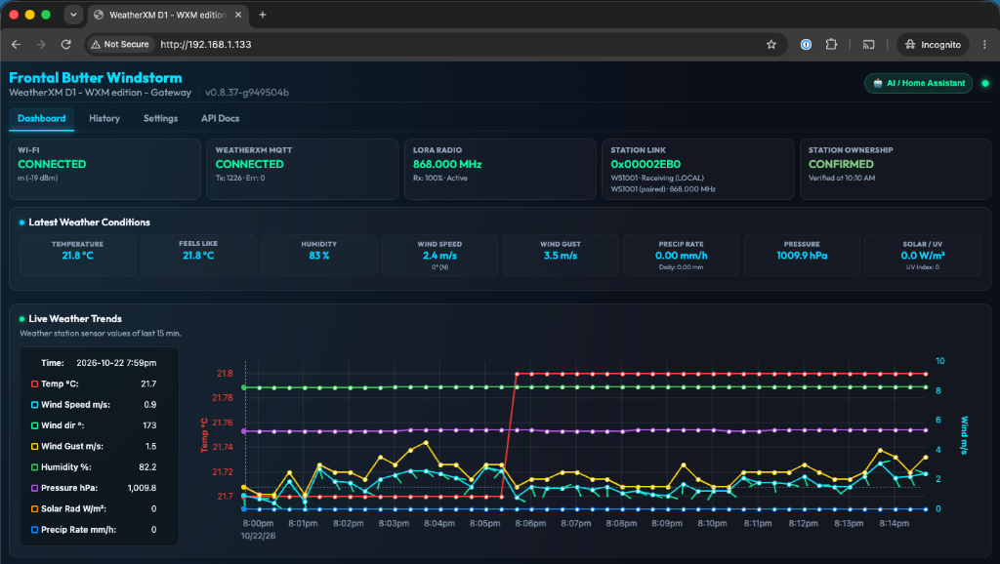
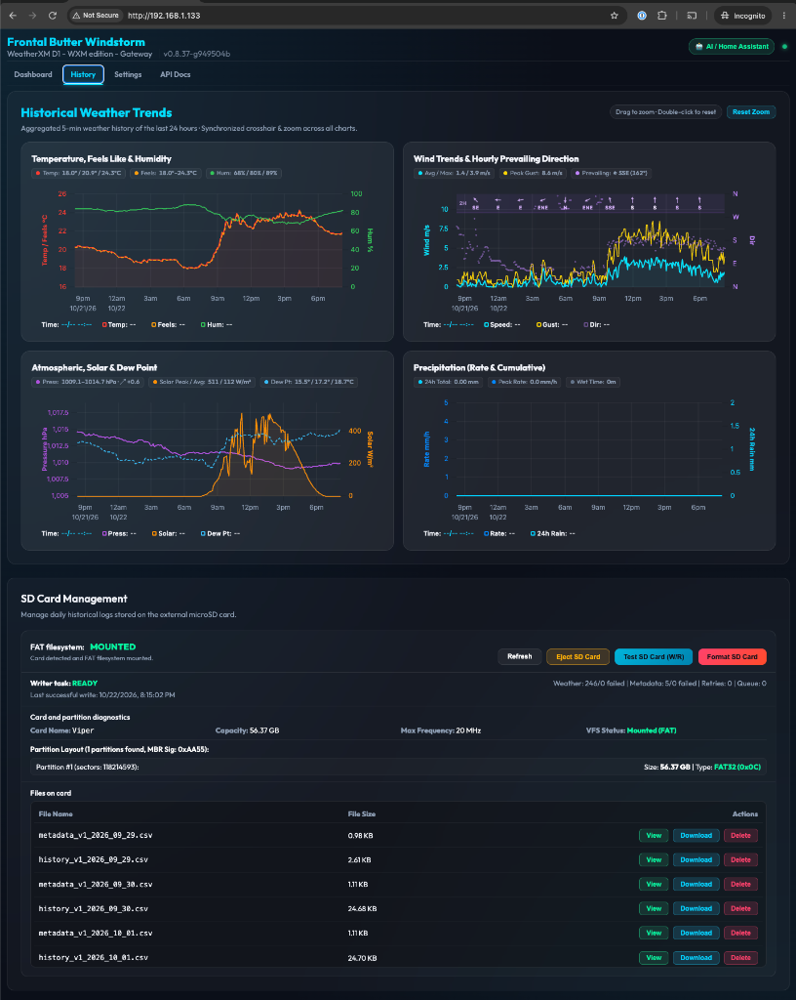
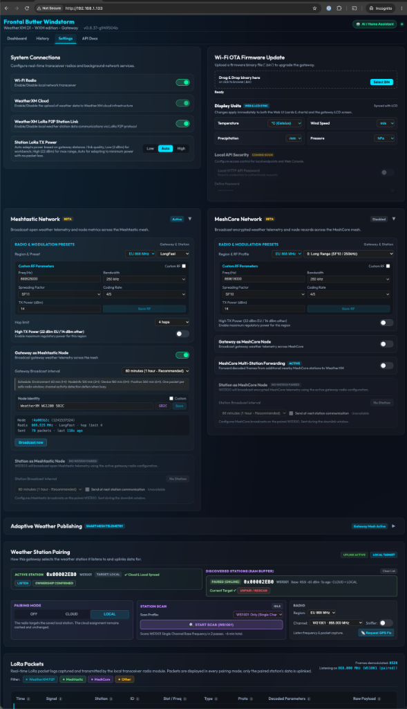
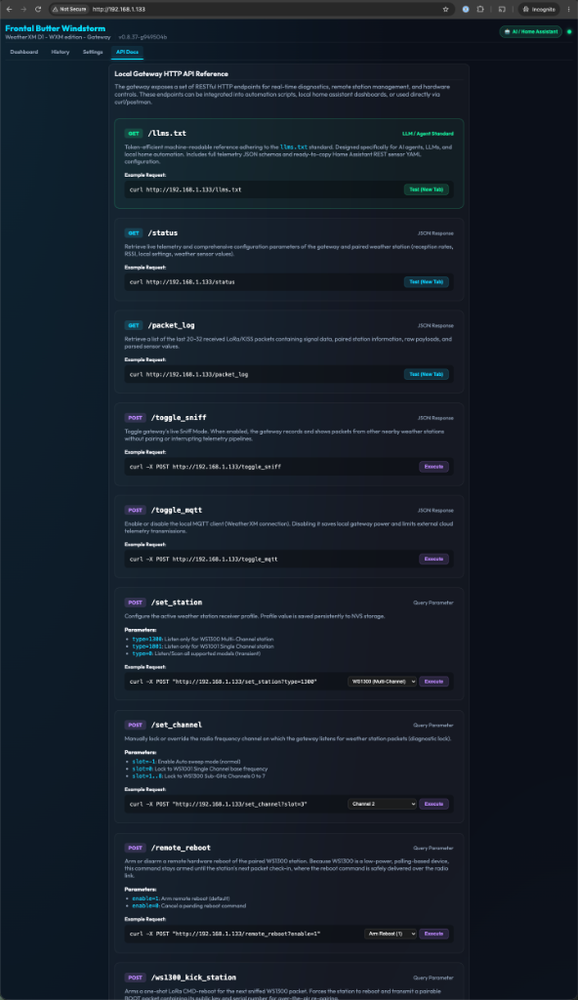

# WeatherXM Gateway Firmware (WG1200)

This repository contains the open source firmware supporting the **WeatherXM WG1200 (Standard Gateway with LCD)** as well as **Screenless / Solar-powered Gateway** configurations.

* **Custom / Community Firmware Guide:** [`CUSTOM_FIRMWARE.md`](CUSTOM_FIRMWARE.md) — build and customize the Open Edition; for the production-hardware unlock path and unified flasher workflow, see [`docs/community-firmware-unlock.md`](docs/community-firmware-unlock.md).
* **Community Firmware Unlock Architecture & Rollout:** [`docs/community-firmware-unlock.md`](docs/community-firmware-unlock.md) — the implementation plan for owner unlock, the signed chainloader, and [flasher.weatherxm.com](https://flasher.weatherxm.com) as the firmware control point.
* **Communications Architecture & Timing Flow**: [`docs/communications_flow.md`](docs/communications_flow.md)
* **SD Weather History & Aggregation**: [`docs/sd_weather_storage.md`](docs/sd_weather_storage.md)
* **Pairing Lifecycle & States**: [`docs/pairing_states.md`](docs/pairing_states.md)
* **WS1300 Pairing Flow**: [`docs/ws1300_pairing_flow.md`](docs/ws1300_pairing_flow.md)
* **Release Changelog**: [`CHANGELOG.md`](CHANGELOG.md)

---

## Local Web Console & REST API (`http://<gateway-ip>/`)

Every WG1200 gateway serves a built-in, gzip-compressed local web console (`v0.8.37`) over HTTP with mDNS discovery (`_weatherxm._tcp`), real-time weather charts, microSD history management, bidirectional LCD ↔ Web unit synchronization, Meshtastic / MeshCore mesh configuration, live LoRa packet inspection, and an interactive REST API & `/llms.txt` endpoint for Home Assistant and AI agents.

### Interactive Slideshow

<p align="center">
  
</p>

### Web Console Tabs (Click to Open Full Resolution)

| 1. Live Dashboard | 2. 24h History & SD Card | 3. Settings, Mesh & Pairing | 4. Local REST API & `/llms.txt` |
| :---: | :---: | :---: | :---: |
| <a href="docs/images/webui_dashboard.png"></a> | <a href="docs/images/webui_history.png"></a> | <a href="docs/images/webui_settings.png"></a> | <a href="docs/images/webui_api_docs.png"></a> |
| Real-time link telemetry, latest weather cards, daily rain accumulation, and 15-min live multi-axis trends. | 24-hour 5-min historical trends with hourly prevailing wind ribbon, synchronized crosshairs/zoom, and microSD CSV management + safe eject. | System radio controls, Wi-Fi OTA update, bidirectional Web ↔ LCD display units sync, Meshtastic & MeshCore nodes, station pairing, and live LoRa packet sniffer. | Interactive REST API explorer, one-click command execution, Home Assistant YAML generator, and `/llms.txt` agent reference. |

<details>
<summary><strong>📸 Expand Full-Page Screenshots Inline</strong></summary>
<br>

#### 1. Dashboard — Live Telemetry & 15-Minute Weather Trends
<p align="center">
  
</p>

#### 2. History — 24-Hour Historical Weather Trends, Hourly Wind Ribbon & SD Card Management
<p align="center">
  
</p>

#### 3. Settings — System Connections, Display Units Sync, Meshtastic / MeshCore & Station Pairing
<p align="center">
  
</p>

#### 4. API Docs — Local Gateway HTTP API Reference & `/llms.txt`
<p align="center">
  
</p>

</details>

---

## Custom / Community firmware: designed for AI-driven development

The D2 firmware workflow is designed around a short **build → flash → inspect → change → repeat**
loop that can be driven by a developer, a script, or an AI coding agent.

The plan is to use **[flasher.weatherxm.com](https://flasher.weatherxm.com)** as the single
owner-facing firmware control point for D2 hardware:

- **WG1200:** firmware operations over USB / Web Serial. The current
  [`WeatherXM/web-flasher`](https://github.com/WeatherXM/web-flasher) already performs guarded
  browser flashing while preserving protected credentials and the factory recovery image.
- **WS1300:** firmware operations over Bluetooth LE DFU. The web flasher will add the WS1300 BLE
  path described in the [community firmware unlock plan](docs/community-firmware-unlock.md), so the
  station does not need a USB connection.
- **WS1300 Developer TUI:** [`WeatherXM/ws1300-firmware/tools/ws1300_dev_tui.py`](https://github.com/WeatherXM/ws1300-firmware/blob/main/tools/ws1300_dev_tui.py)
  already provides BLE discovery, shell access, diagnostics, MCUboot slot inspection and dual-core
  DFU, with headless `--scan`, `--cmd` and `--flash` modes for automation.

These interfaces are deliberately scriptable and machine-readable. A local AI agent or CI runner
can keep a **WG1200 attached over USB** and a **WS1300 reachable over BLE**, then:

1. change and build gateway/station firmware;
2. flash the WG1200 over USB;
3. flash the WS1300 over BLE DFU;
4. query the station shell and diagnostics;
5. inspect WG1200 serial output, local HTTP APIs and decoded station packets;
6. verify the change and iterate again.

That makes hardware-in-the-loop **AI CI/CD** practical without repeatedly opening devices,
connecting an SWD debugger, or moving firmware files by hand. Production-locked devices use the
one-way authenticated unlock and signed-chainloader process defined in
[`docs/community-firmware-unlock.md`](docs/community-firmware-unlock.md).

---

## 1. Supported Hardware Architectures

The firmware targets multiple hardware platforms using a single unified codebase:

### WG1200 (Standard Gateway)
* **MCU**: ESP32-S3 (standard dev kit or custom PCB)
* **Peripherals**: Direct LCD Display (using LVGL) and SPI-connected SX1262 LoRa module
* **Power**: Mains / USB-C powered (continuous operation)

### WG1200 Screenless / Solar Configuration
* **MCU**: Seeed Studio XIAO ESP32-S3 or LilyGO T-SIM7000G
* **Peripherals**: Headless / Screenless, Seeed Studio XIAO nRF52 coprocessor running Meshcore KISS firmware + SX1262 LoRa module
* **Inter-Chip Communications**: High-speed UART Serial using the KISS protocol over pins D6 (TX) and D7 (RX)
* **Power**: Solar-powered duty cycling (60-second awake cycle, 5-minute deep sleep)

---

## 2. Requirements for Development

1. **VS Code with PlatformIO IDE Extension** (or `pio` command-line tool).
2. **ESP32-S3 Hardware**:
   * For **WG1200**: Standard ESP32-S3 board with LCD display and SX1262 SPI module.
   * For **Screenless**: Seeed Studio XIAO ESP32-S3 connected to a Seeed Studio XIAO nRF52 running meshcore KISS firmware over serial.

---

## 3. How to Build & Flash

### Building Open / Community Edition (Default)

The repository builds an open, safe developer edition out of the box that **does not burn hardware eFuses** and uses NVS-based virtual keys:

```bash
# Clone the repository
git clone https://github.com/WeatherXM/wg1200-firmware.git
cd wg1200-firmware

# Build Open Edition (Default)
pio run -e wg1200_open

# Upload and monitor serial console
pio run -e wg1200_open -t upload -t monitor
```

The Open Edition defaults to the public WeatherXM development MQTT configuration in
[`main/include/env.build_env.h.template`](main/include/env.build_env.h.template).
System integrators can point the gateway at their own infrastructure by providing a local
`main/include/env.release.h` (gitignored) with their MQTT broker/DNS settings, or by adapting
the uploader/backend code for their deployment.

### Alternative Environments

* **Debug Build** (same open security policy, debug logging/optimization):
  ```bash
  pio run -e wg1200_debug -t upload
  ```
* **Screenless / Solar (XIAO ESP32-S3)**:
  ```bash
  pio run -e xiao_esp32s3 -t upload
  ```

---

## 4. Key Security & Operational Notes

* **eFuse Safety**: The default `wg1200_open` profile stores device keys in NVS (`wxm_virt`) and never touches physical eFuses. It is completely safe for standard development boards.
* **Station Authentication**: Default open pre-shared keys are provided in [`main/ws/supported/ws_1300/include/ws_1300_keys.h`](main/ws/supported/ws_1300/include/ws_1300_keys.h), enabling instant pairing with [WS1300 Open Edition firmware](https://github.com/WeatherXM/ws1300-firmware).
* **Production Manufacturing**: The `wg1200_production` environment is strictly reserved for WeatherXM internal factory manufacturing and burns permanent hardware eFuses.

See [`CUSTOM_FIRMWARE.md`](CUSTOM_FIRMWARE.md) for full custom firmware and private key instructions.

---

## 5. License

WeatherXM-authored source code is licensed under the Apache License, Version 2.0. Third-party components remain subject to their respective licenses; see [`THIRD_PARTY_NOTICES.md`](THIRD_PARTY_NOTICES.md) and [`LICENSE`](LICENSE).
