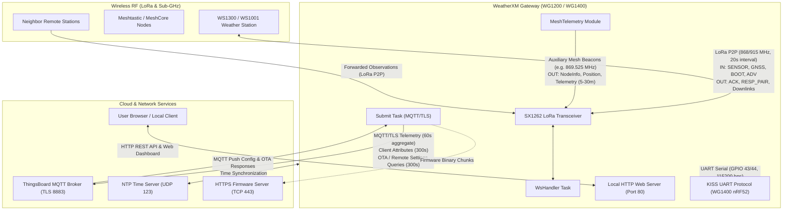

# Gateway Communications Architecture & Flow (WG1200 & WG1400)

This document describes all incoming and outgoing communication channels, protocols, packet types, and execution intervals for the WeatherXM Gateway firmware (WG1200 & WG1400).

---

## 1. High-Level Communications Architecture



---

## 2. Communications & Timing Matrix

| Interface                       | Protocol / Layer                                        | Direction | Channel / Topic / Endpoint                                                     | Frequency / Interval                                                         | Purpose & Payload                                                                                                                                                                                         |
|:------------------------------- |:------------------------------------------------------- |:--------- |:------------------------------------------------------------------------------ |:---------------------------------------------------------------------------- |:--------------------------------------------------------------------------------------------------------------------------------------------------------------------------------------------------------- |
| **LoRa Station Link**           | Proprietary FSK/LoRa (SX1262)                           | **IN**    | WS Channel (CH0-CH7 / Base)                                                    | Every **20s** (WS1300/WS1001)                                                | `SENSOR` (Temp, Humidity, Pressure, Rain, Wind, Battery, Solar), `GNSS` (GPS fix/time), `BOOT`/`ADV` (Station ID, SN, Pubkey).                                                                            |
| **LoRa Station Downlink**       | Proprietary LoRa (SX1262)                               | **OUT**   | WS Channel (CH0-CH7 / Base)                                                    | Synchronous ($+30\text{ms}$ post-RX)                                         | `ACK`, `RESP_PAIR`, remote commands (TX power/interval override, reboot, GPS trigger, ownership challenge).                                                                                               |
| **Meshtastic Telemetry**        | Meshtastic LoRa (869.525 MHz EU868 / 906.875 MHz US915) | **OUT**   | Secondary / Mesh Frequency                                                     | Configurable (**5m, 10m, 15m, 30m, 60m**; default 60m with 30m phase offset) | Weather Telemetry, NodeInfo (with X.509 cert fingerprint & unmessagable flag), and Position packets broadcast to Meshtastic mesh networks. See [Meshtastic Integration Guide](meshtastic_integration.md). |
| **MeshCore Telemetry**          | MeshCore KISS / LoRa                                    | **OUT**   | MeshCore Frequency                                                             | Configurable (**5m, 10m, 15m, 30m, 60m**; default 60m with 30m phase offset) | Compact compressed weather and diagnostic packets for MeshCore networks.                                                                                                                                  |
| **ThingsBoard Telemetry**       | MQTT over TLS 8883 (DS RSA signed)                      | **OUT**   | `v1/devices/me/telemetry`                                                      | Every **60s**                                                                | 1-minute aggregated weather field pack signed with hardware secure element / RSA key.                                                                                                                     |
| **ThingsBoard Attributes**      | MQTT over TLS 8883                                      | **OUT**   | `v1/devices/me/attributes`                                                     | Every **300s** (5 min)                                                       | Client attributes: Wi-Fi RSSI, gateway timestamp, packet reception %, station ID, pairing status.                                                                                                         |
| **ThingsBoard OTA & RS**        | MQTT over TLS 8883                                      | **BIDIR** | `v1/devices/me/attributes/request/1`<br/>`v1/devices/me/attributes/response/+` | Every **300s** (5 min)                                                       | Queries available firmware updates and cloud remote settings configurations.                                                                                                                              |
| **ThingsBoard RPC / Push**      | MQTT over TLS 8883                                      | **IN**    | `v1/devices/me/rpc/request/+`<br/>`v1/devices/me/attributes`                   | Asynchronous (Server push)                                                   | Cloud-triggered configuration updates or diagnostic requests.                                                                                                                                             |
| **Local Web Server**            | HTTP / REST (Port 80)                                   | **BIDIR** | `/`, `/status`, `/api/v1/*`                                                    | On-Demand (Local client)                                                     | Web dashboard, manual pairing/scan controls, mesh parameter configuration, manual OTA upload.                                                                                                             |
| **Coprocessor Link** *(WG1400)* | UART KISS (GPIO 43/44)                                  | **BIDIR** | 115200 bps Serial                                                              | Continuous / Event-Driven                                                    | Exchanging raw LoRa frames, RSSI/SNR metrics, and radio leases with the nRF52 coprocessor.                                                                                                                |
| **NTP Client**                  | SNTP (UDP 123)                                          | **BIDIR** | `pool.ntp.org`                                                                 | Boot & Periodic Drift Sync                                                   | Syncs on-board RTC with global atomic time.                                                                                                                                                               |

---

## 3. 20-Second Station, Gateway, Mesh, and MQTT Timeline

To ensure zero packet collisions over the shared SX1262 LoRa radio and I2C IO expander, all operations follow a phase-aligned schedule relative to the station's 20-second transmission:

```mermaid
sequenceDiagram
    autonumber
    participant WS as WS1300 Station
    participant SX as SX1262 Radio & WsHandler
    participant MESH as MeshTelemetry
    participant SUBMIT as Submit Task (MQTT/TLS)
    participant TB as ThingsBoard Cloud

    Note over WS,SX: t = 0.0s : Station Transmission Window
    WS->>SX: Transmit LoRa SENSOR / GNSS Packet (~50ms airtime)
    SX-->>WS: Gateway LoRa ACK / RESP_PAIR (~30ms airtime)
    Note over SX: Outcome recorded; Radio leased for auxiliary mesh

    Note over SX,MESH: t = 0.1s - 5.5s : Gateway Auxiliary Mesh Window
    SX->>MESH: Radio lease granted (expiring before next station RX)
    MESH->>SX: Transmit Meshtastic / MeshCore Beacon (if scheduled)
    Note over SX: SX1262 returned to continuous WS reception

    Note over SUBMIT,TB: t = 6.0s - 17.0s : SAFE QUIET WINDOW (No LoRa Traffic)
    SUBMIT->>SX: Pre-Submit Guard Check (is_in_station_packet_guard_window)
    SX-->>SUBMIT: SAFE (Elapsed = 6.0s, Remaining = 14.0s)
    SUBMIT->>TB: Publish 60s Weather Telemetry (RSA Signed)
    opt Every 300s (5 minutes)
        SUBMIT->>TB: Query OTA Firmware Attributes & Remote Settings
        TB-->>SUBMIT: Return Attributes Response
        SUBMIT->>TB: Publish Client State Attributes
    end

    Note over SUBMIT: t = 8.0s : Submit Task Complete (Sleeps)
    Note over SX: t = 8.0s - 20.0s : Quiet Continuous RX Waiting

    Note over WS,SX: t = 20.0s : Next Station Cycle Begins (t = 0.0s)
```

---

## 4. Collision Avoidance & Guard Mechanism

1. **Pre-Submit Collision Guard** (`WsHandler::is_in_station_packet_guard_window`):
   
   * **Danger Zone 1 (Post-Packet Cooldown, $0 \dots 5.5\text{s}$)**: Gateway ACK and auxiliary mesh transmissions take place. If MQTT submit triggers here, it is deferred to $+6.0\text{s}$.
   * **Danger Zone 2 (Pre-Packet Window, within $3.0\text{s}$ of expected packet)**: If MQTT submit wakes up when remaining time $T_\text{rem} < 3000\text{ms}$, it sleeps for $T_\text{rem} + 6000\text{ms}$ to execute safely after packet reception.
   * **Safe Quiet Window ($5.5\text{s} \dots 17.0\text{s}$)**: Free from station or mesh transmissions; ideal for multi-packet Wi-Fi/TLS and hardware RSA digital signature transactions.

2. **Phase-Offset Mesh Protocol Transmission**:
   
   * Auxiliary mesh protocols (Meshtastic / MeshCore) enforce a **$+5\text{s}$ delay** post-station ACK to de-conflict station and gateway broadcasts.
   * Mesh intervals (e.g. 30m) employ a **15m phase offset** (`interval / 2`) between station and gateway transmissions.
