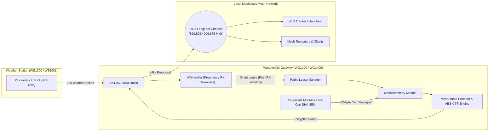
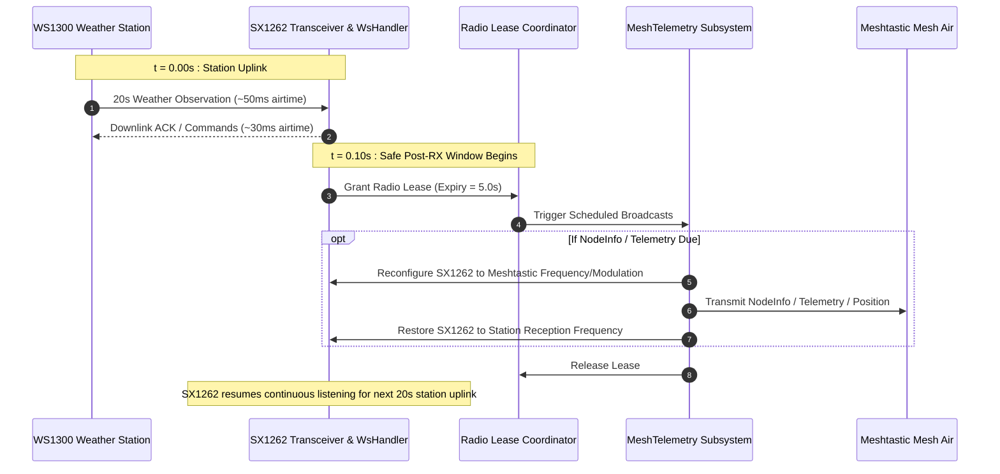

# Meshtastic Integration Guide (WG1200 & WG1400)

This document describes the technical implementation, wire format, cryptographic identity, scheduling, and communication flow for Meshtastic beaconing on the WeatherXM Gateway (WG1200 and WG1400).

---

## 1. Overview & Architecture

The WeatherXM Gateway firmware includes a dedicated `MeshTelemetry` subsystem that periodically broadcasts standardized Meshtastic packets over LoRa. This allows nearby Meshtastic nodes (e.g. handhelds, base stations, repeater nodes, e-ink trackers) to receive local weather observations, station identity, and diagnostic telemetry without needing an internet connection.



---

## 2. Wire Format & Protobuf Schemas

The gateway transmits standard Meshtastic wire packets on the default **`LongFast`** profile. The frame format consists of:
1. **Radio Header (16 bytes)**:
   - Destination Node ID (4 bytes, Little-Endian): `0xFFFFFFFF` (Broadcast)
   - Sender Node ID (4 bytes, Little-Endian): `0xXXXXXXXX` (Derived from Gateway MAC)
   - Packet ID (4 bytes, Little-Endian): Monotonically incrementing 32-bit counter
   - Flags (1 byte): `hop_limit` (bits 0–2), `want_ack` (bit 3), `via_mqtt` (bit 4), `hop_start` (bits 5–7)
   - Channel Hash (1 byte): `0x08` (Default LongFast channel hash)
   - Next Hop / Relay Node (2 bytes): `0x00, 0x00`
2. **Encrypted Payload (AES-128-CTR)**:
   - Wrapped `meshtastic.Data` protobuf containing the decrypted port payload.

### Supported Meshtastic Applications & Ports:

| Application / Port | Portnum | Nanopb / Proto Message | Contents |
| :--- | :--- | :--- | :--- |
| **`NODEINFO_APP`** | `4` | `meshtastic.User` | Advertises gateway identity, callsign/name, hardware model, role, 32-byte public key fingerprint, and unmessagable flag. |
| **`TELEMETRY_APP` (Environment)** | `67` | `meshtastic.Telemetry` (`environment_metrics`) | Ambient temperature ($^\circ\text{C}$), relative humidity (%), barometric pressure ($\text{hPa}$), illuminance ($\text{lux}$), wind direction ($^\circ$), wind speed ($\text{m/s}$), wind gust ($\text{m/s}$), and rainfall ($\text{mm}$). |
| **`TELEMETRY_APP` (Device)** | `67` | `meshtastic.Telemetry` (`device_metrics`) | Gateway supply voltage ($\text{V}$), external power indicator (`battery_level = 101`), and system uptime ($\text{s}$). |
| **`POSITION_APP`** | `3` | `meshtastic.Position` | Gateway GNSS latitude/longitude (in integer degrees $\times 10^7$), altitude ($\text{m}$), and timestamp. |

---

## 3. Cryptographic Identity & NodeDB Retention

### Protobuf Field Layout for `meshtastic.User`:

```protobuf
message User {
  string id = 1;                         // "!xxxxxxxx" (hexified node ID)
  string long_name = 2;                  // "WeatherXM WG1200 XXXX" (default, or custom device name; max 23-24B)
  string short_name = 3;                 // "GXXX" (role prefix 'G' + 3 hex digits, 4 chars max)
  HardwareModel hw_model = 5;            // PRIVATE_HW = 255
  Config.DeviceConfig.Role role = 7;     // SENSOR = 6
  bytes public_key = 8;                  // 32-byte SHA-256 fingerprint of device certificate
  bool is_unmessagable = 9;              // true (1)
}
```

### Why Field 8 and Field 9 are Essential:
1. **NodeDB Retention ("Boring Node" Eviction Prevention)**:
   - In standard Meshtastic nodes, memory is bounded (typically 80–120 nodes). When capacity is reached, nodes with `public_key.size == 0` are classified as "boring" and evicted on every new packet.
   - Populating **Field 8** with a valid 32-byte public key ensures the gateway is treated as a permanent peer and retained in the NodeDB.
2. **Deterministic Cryptographic Mapping**:
   - The 32-byte key is computed as the **SHA-256 fingerprint of the gateway's ThingsBoard X.509 client certificate** (`Credentials::get_dev_cert_fingerprint()`), or the SHA-256 of the hardware serial number if no certificate is installed.
   - This binds the Meshtastic node identity to the physical gateway's cloud-authenticated hardware identity.
3. **Unmessagable Beacon Flag (Field 9)**:
   - Explicitly sets `is_unmessagable = true`, informing mesh clients and UIs that the gateway is an autonomous sensor beacon and does not process incoming direct messages or text chats.

---

## 4. Encryption & Channel Parameters

* **Modulation**: LoRa bandwidth 250 kHz, Spreading Factor SF11, Coding Rate 4/5, Preamble 16 symbols, Sync Word `0x2B` (`0x24, 0xB4` on SX126x).
* **Frequencies**:
  * `EU868`: 869.525 MHz (Slot 0)
  * `US915`: 906.875 MHz (Slot 19)
  * `AS923`: 923.875 MHz (Slot 15)
  * `AU915`: 916.875 MHz (Slot 20)
* **Default PSK**: `1PG7OiApBqPvdXCbugjMpA==` (`0xD4, 0xF1, 0xBB, 0x3A, 0x20, 0x29, 0x07, 0x59, 0xF0, 0xBC, 0xFF, 0xAB, 0xCF, 0x4E, 0x69, 0x01`).
* **AES-CTR Nonce Construction**:
  $$\text{Nonce} = \text{packet\_id (4B LE)} \parallel \text{from\_node (4B LE)} \parallel \text{block\_counter (4B LE)} \parallel 0x00000000$$

---

## 5. Radio Leasing & Scheduling Timeline

The gateway uses a single SX1262 LoRa transceiver to both listen for 20-second proprietary weather station transmissions and transmit auxiliary Meshtastic beacons. To prevent packet collisions or missing incoming station observations, the `MeshTelemetry` module operates via a strict **Radio Lease** mechanism:



### Transmission Cadence:

* **On Boot / Reset**: Immediately transmits `NodeInfo`, followed by `Environment Telemetry`, and `Position` (if GNSS fix is valid).
* **Periodic Cadence (Multiplier of Configured Interval $I$, default $I = 30$ min)**:
  * **Environment Telemetry**: Every $1 \times I$ (Every 30 minutes)
  * **NodeInfo**: Every $2 \times I$ (Every 60 minutes)
  * **Device Metrics**: Every $3 \times I$ (Every 90 minutes)
  * **Position**: Every $6 \times I$ (Every 180 minutes, if GNSS fix available)
