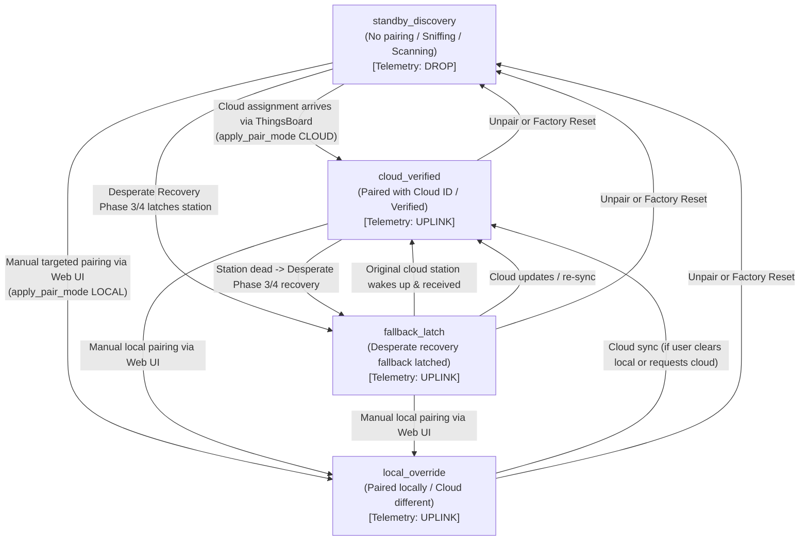

# Gateway Pairing Architecture and Lifecycle States

This document formally defines the pairing architecture, operational lifecycle states, state transitions, and fallback behaviors in the WG1200 / WG1400 firmware.

---

## 1. Core Pairing Lifecycle States

The firmware defines four canonical pairing lifecycle states that describe the operational state of the station link and telemetry authorization:



### 1.1 `standby_discovery`
- **Definition**: The gateway has no active station pairing. This occurs on factory reset, empty/wiped NVS out-of-the-box, when no cloud station is provisioned, during an unpair action, or while an active discovery scan or manual channel listen is running.
- **RF Radio State**: The LoRa/FSK radio receiver is active and sniffing across frequencies (or sweeping channels). Received packets are decoded and displayed on the local screen and in the Web UI live packet sniffer/station directory.
- **Telemetry Authorization**: Weather packets are **dropped** before the internal `WsData` ring buffer. Zero weather telemetry points are uploaded to ThingsBoard (`ts_kv`).
- **Transition Out**:
  - Automatically transitions to `cloud_verified` when ThingsBoard delivers a valid station ID (`shared/station`).
  - Transitions to `local_override` if the operator performs a targeted pairing via the local Web UI.
  - Transitions to `fallback_latch` if automated recovery reaches Phase 3 or Phase 4 and latches onto any available WeatherXM station.

### 1.2 `cloud_verified`
- **Definition**: The normal production operating state. The gateway is configured with a Cloud station profile (`PairMode::PAIR_MODE_CLOUD`), the Local profile mirrors or matches the Cloud ID, and station identity/ownership is confirmed.
- **RF Radio State**: Tuned strictly to the assigned station's channel/frequency slot. For WS1300 stations, downlinks (`RESP_PAIR`, time sync, GPS requests) are transmitted on the matched channel.
- **Telemetry Authorization**: Weather observations are ingested into `WsData` and published periodically to ThingsBoard.
- **Verification Criteria**:
  - For **WS1300**: Cryptographic ownership challenge is armed and verified via GPS response / ECDSA public key.
  - For **WS1001**: Station ID matches the authoritative Cloud profile.

### 1.3 `local_override`
- **Definition**: The gateway is paired with a locally chosen station (`PairMode::PAIR_MODE_LOCAL`). The local pairing takes operational precedence over any Cloud profile (whether the Cloud ID is different or absent).
- **RF Radio State**: Tuned to the locally paired station's slot/frequency.
- **Telemetry Authorization**: Weather observations from the local station are ingested and uplinked.
- **Design Guarantee**: Remote ThingsBoard shared attribute updates will **never overwrite or clobber** an active `local_override` pairing. The gateway preserves the cached Cloud profile independently in NVS without applying it to the radio link until the operator explicitly switches back.

### 1.4 `fallback_latch`
- **Definition**: An automated recovery state reached when a previously configured station (Cloud or Local) stops transmitting for an extended period, and the gateway's autonomous fallback state machine latches onto an available WeatherXM station to restore telemetry flow.
- **RF Radio State**: Tuned to the candidate station latched during Phase 3 (`PHASE_WS1001_SCAN`) or Phase 4 (`PHASE_WS1300_SWEEP`).
- **Telemetry Authorization**: Weather data from the latched station is ingested into `WsData` and uplinked, preventing data blackouts.
- **Reversion Guarantee**: If the original configured station comes back online (e.g. solar panel charges battery after sunrise), the gateway immediately recognizes packets matching the cloud/local profile and promotes back to `cloud_verified` or `local_override`.

---

## 2. Supporting Modes

### `monitor_only` (`PAIR_MODE_OFF`)
- The radio remains tuned to sniff and decode packets, but all weather uploads (`submit_ws_data`, `submit_gps_data`) and downlink transmissions (`RESP_PAIR`, commands) are suppressed.
- Existing pairing credentials in NVS are preserved.

### Fallback Recovery Phases
When an established station goes silent, the gateway cycles through automated recovery phases before entering `fallback_latch`:

| Phase | Identifier | Duration | Action |
| --- | --- | --- | --- |
| Phase 1 | `local` (`PHASE_LOCAL_NVS`) | 5 min | Listen for persisted local station profile |
| Phase 2 | `cloud` (`PHASE_CLOUD_NVS`) | 5 min | Listen for cloud station profile |
| Phase 3 | `ws1001_scan` (`PHASE_WS1001_SCAN`) | 5 min | Scan base frequency for WS1001 stations; latch if detected |
| Phase 4 | `ws1300_sweep` (`PHASE_WS1300_SWEEP`) | 16 min | Sweep WS1300 channels 0–7 (2 min dwell each); latch if detected |
| Phase 5 | `cooldown` (`PHASE_COOLDOWN`) | 30 min | Rest radio and retry from Phase 1 |
| Latched | `latched` (`PHASE_LATCHED`) | Indefinite | Candidate station latched; state is `fallback_latch` |

---

## 3. Storage and Data Flow Independence

| Profile Slot | NVS Keys | Persisted Attributes | Mutation Safety |
| --- | --- | --- | --- |
| **Cloud Profile** | `cloud_ws_id`, `cloud_ws_sn`, `cloud_ws_pubkey`, `cloud_ws_type`, `cloud_ws_valid` | Authoritative cloud station ID, serial number, public key | Updated only by ThingsBoard RPC/attribute sync. Never mutated by manual local scans. |
| **Local Profile** | `ws_id`, `ws_sn`, `ws_pubkey`, `ws_type`, `local_ws_ready` | Locally paired station ID, serial number, public key | Updated by local pairing, UI scan adoption, or fallback latching. Never overwrites Cloud profile. |

---

## 4. Web API and Telemetry Schema

The `/api/status` endpoint and WebSocket status payloads expose the pairing state:

```json
{
  "pair_mode": "cloud",
  "pair_source": "cloud",
  "operation_mode": "cloud",
  "pairing_state": "cloud_verified",
  "ownership_status": "confirmed",
  "fallback_phase": "local",
  "local_ws_id": 14500,
  "cloud_ws_id": 14500,
  "is_paired": true,
  "active_link": true,
  "uplink_active": true
}
```

- `pairing_state`: Canonical lifecycle state (`standby_discovery`, `cloud_verified`, `local_override`, `fallback_latch`, `monitor_only`).
- `pair_mode`: Persisted NVS mode (`cloud`, `local`, `scan`, `off`).
- `pair_source`: Source of current active profile (`cloud`, `local`, `none`).
- `operation_mode`: Radio operational activity (`cloud`, `local`, `scan`, `listen`, `repair`, `off`).
- `ownership_status`: Cryptographic ownership check (`confirmed`, `unverified`, `pending`, `failed`, `receive_only`).
