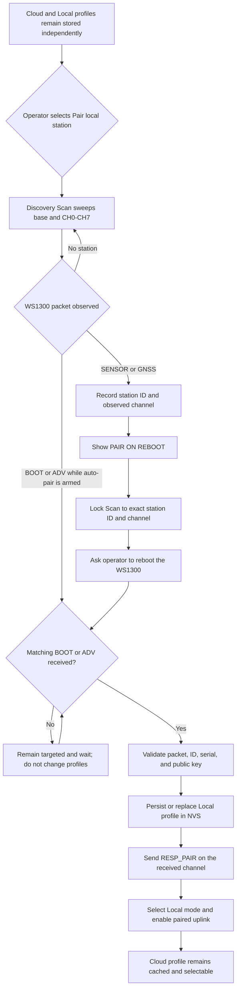

# WS1300 Local Pairing Flow (Firmware 0.8.3)

This document describes the simplified local-station pairing flow implemented
in firmware 0.8.3. Its purpose is to let a gateway retain a cloud-configured
station while independently discovering, pairing, and permanently storing a
different locally detected WS1300.

> [!NOTE]
> For the comprehensive pairing architecture across all station types and the four canonical lifecycle states (`standby_discovery`, `cloud_verified`, `local_override`, and `fallback_latch`), see [docs/pairing_states.md](pairing_states.md).

## Design guarantees

- Cloud and Local station profiles are stored independently.
- Selecting or replacing Local never overwrites the cached Cloud profile.
- Only one profile is active on the radio because the gateway can listen on
  only one WS1300 channel at a time.
- A normal `SENSOR` or `GNSS` packet is enough to discover a station ID and its
  channel, but not enough to pair it.
- Permanent pairing requires a valid `BOOT` or `ADV` packet because those
  packets provide the station serial number and public key.
- Targeted pairing filters both the station ID and channel, preventing a nearby
  station from being adopted accidentally.
- Successful targeted pairing persists the Local profile in NVS, changes the
  selected mode to Local, and leaves Cloud available for later selection.

## Simplified flow



## Operator workflow

1. Select **Scan** to discover nearby stations. An unrestricted scan visits the
   base channel and WS1300 CH0 through CH7. With the current 22-second dwell,
   one complete sweep takes 198 seconds.
2. When the recent-station directory shows a WS1300 `SENSOR` or `GNSS` packet,
   select **Pair on reboot**.
3. The gateway enters targeted Scan using the detected station ID and channel.
   Confirm that the dashboard says `TARGETED PAIR` before rebooting the station.
4. Reboot the WS1300. Do not press Pair again: its next matching `BOOT` packet
   automatically completes the gateway-side pairing.
5. Confirm that the dashboard changes to `LOCAL TARGET`, `active_link` becomes
   true, and `local_profile_ready` is true.

If an `ADV` or `BOOT` packet is already being transmitted while targeted Scan
is active, pairing can complete without another reboot.

## State transition and persistence

The relevant persisted modes are:

| Mode | Behaviour |
| --- | --- |
| Off | Receive-only diagnostics. Saved Cloud and Local profiles are retained; downlinks and weather uplink are disabled. |
| Cloud | Tunes the radio for the cached Cloud station and enables its uplink. Local remains stored. |
| Local | Tunes the radio for the persisted Local station and enables its uplink. Cloud remains stored. |
| Scan | Enables auto-pairing. It may sweep all channels or stay locked to an exact station ID/channel. |

On a successful WS1300 pair, the handler performs this atomic logical
transition:

1. Extract station ID, serial number, public key, and type from `BOOT`/`ADV`.
2. Save those values to the Local profile.
3. Mark the Local profile valid and ready.
4. Clear the temporary Scan target.
5. Persist Local as the selected pair mode/source.
6. Send the authenticated `RESP_PAIR` on the receive frequency.
7. Retune for normal Local operation and accept only the selected station's
   weather data for uplink.

The Cloud ID, serial, public key, type, and validity flag are not changed by
this transition.

## Pairing conditions

Automatic pairing occurs only when all the following are true:

1. The gateway is in Scan with auto-pair enabled and runtime state unpaired.
2. No manual Listen-only channel override is active.
3. The packet decodes as the selected station type or the receiver is in
   all-station discovery mode.
4. The WS1300 packet is `BOOT` or `ADV`; `SENSOR` and `GNSS` remain discovery
   packets only.
5. The station ID matches the configured target when targeted pairing is used.
6. The candidate contains a usable ID, serial number, and public key.

The dashboard action maps to the existing atomic endpoint:

```text
POST /set_pair_mode?mode=scan&id=0x<station-id>&slot=<observed-slot>
```

The status endpoint exposes the transition through `pair_mode`,
`operation_mode`, `scan_target_id`, `scan_target_slot`, `local_ws_id`,
`local_ws_sn`, `local_profile_ready`, `active_link`, and `uplink_active`.

## Pairing versus optional ownership verification

Pairing and ownership verification are deliberately separate:

- **Paired** means the gateway stored a complete Local profile and sent the
  authenticated pair response. Weather reception and uplink can operate.
- **Command path verified** means the station subsequently demonstrated that it
  accepts authenticated downlinks from this gateway.

WS1300 has no explicit `PAIR_ACK`. Receiving later weather broadcasts proves
the RF link but does not prove which nearby gateway the station recognizes as
its owner. The current optional verification sends a GPS request and watches
for the station to enter GPS acquisition or return a GNSS packet. Verification
failure does not delete or disable the Local pairing.

The dashboard should therefore treat GPS verification as an optional diagnostic,
not as a prerequisite for a completed pairing. A future protocol-level
`PAIR_ACK` would provide this proof without using a GPS request.

## Implementation locations

- `main/ws/ws_handler.cpp`: Scan state, target filtering, WS1300 auto-pair,
  profile persistence, pair response, and ownership challenge.
- `main/settings.cpp`: independent Cloud and Local profile storage and readiness
  checks.
- `main/submit.cpp`: cloud assignment caching without Local-profile mutation.
- `main/ws/web_server.cpp`: recent-station directory, **Pair on reboot** action,
  pairing controls, and status reporting.
- `main/ws/supported/ws_1300/`: WS1300 packet decoding, response construction,
  and authentication.

